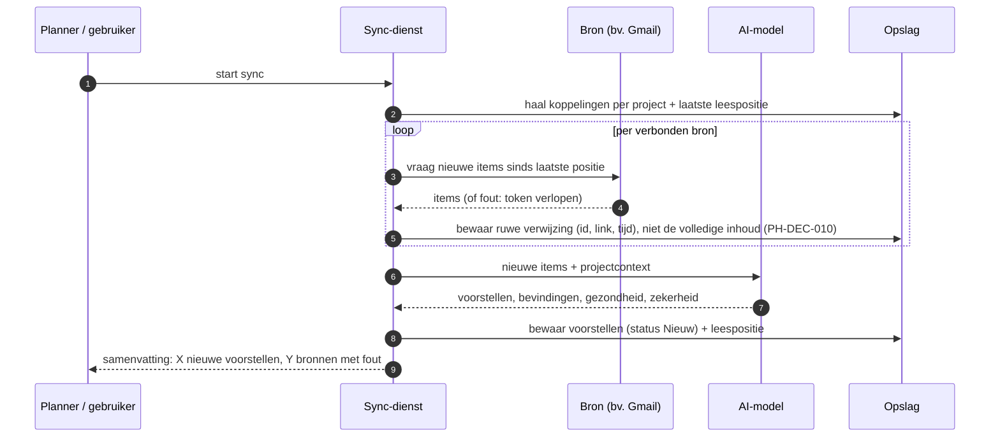

# PH-FLOW-001 — Agent leest bronnen en maakt voorstellen

**Status:** APPROVED (PH-DEC-008) · **Owner:** Lucas · **Last updated:** 2026-10-18 · **Bron:** SRC-DES-001 (Bronnen, Vandaag)

## Doel

De agent leest nieuwe berichten, taken, meetings en documenten uit de gekoppelde bronnen en zet ze om in voorstellen (volgende stap of nieuwe to-do), bevindingen per project en een bijgewerkte projectgezondheid.

## Trigger

- Gepland (prototype toont "laatste sync" en een interval) — frequentie: **PH-DEC-009, NEEDS_INPUT** (bv. elk uur, 3× per dag, of alleen 's ochtends; bepaalt sterk de AI-kost).
- Manueel via "Nu syncen" op het scherm Bronnen.

## Stappen

1. Bepaal welke bronnen verbonden zijn en welke items bij welk project horen (koppelingen uit PH-FLOW-008).
2. Lees per bron alleen wat nieuw is sinds de vorige sync.
3. Faalt een bron (token verlopen, limiet), dan krijgt die bron de status *Opnieuw verbinden* en loopt de sync verder voor de rest.
4. Stuur de nieuwe items met beperkte context naar het AI-model.
5. Het model geeft per item: geen actie, een *volgende stap*, een *nieuwe to-do* of een *bevinding*; telkens met uitleg ("Waarom dit voorstel?"), bronlink en zekerheid (hoog/middel/laag).
6. Ontdubbel: geen tweede voorstel voor hetzelfde bronitem of dezelfde actie.
7. Werk projectgezondheid en "Wat brandt" bij.
8. Bewaar het resultaat en de nieuwe leespositie.

## Regels

- PH-BR-002 (voorgesteld): de agent leest, maar schrijft nooit naar een bron tijdens een sync.
- PH-BR-003 (voorgesteld): elk voorstel heeft een bronlink en een uitleg; zonder bron geen voorstel.
- PH-BR-004 (voorgesteld): een fout in één bron stopt de sync niet.

## Open vragen

- Hoe vaak syncen (PH-DEC-009)?
- Wat bewaren we van de inhoud: alleen verwijzingen en samenvattingen, of volledige tekst (PH-DEC-010, privacy en opslagkost)?
- Wie zijn "klanten" per project: hoe herkent de agent dat een mail bij project X hoort? Voorstel: via de koppelingen (label, kanaal, map) uit PH-FLOW-008.

## Kostendrijvers

Aantal syncs per dag × aantal nieuwe items × gekozen AI-model. Zie `05-architecture/stack-options.md` § AI-kost.
