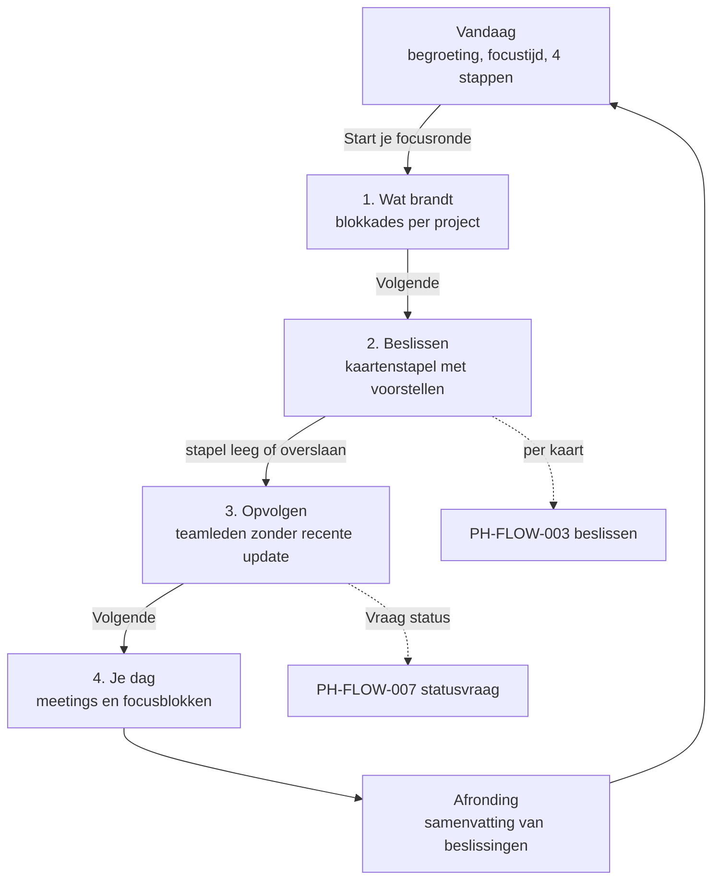

# PH-FLOW-002 — Dagelijkse focusronde

**Status:** PROPOSED · **Owner:** Lucas · **Last updated:** 2026-10-18 · **Bron:** SRC-DES-001 (Vandaag, Focusronde)

## Doel

In één geleide ronde van ongeveer een kwartier alles afhandelen wat vandaag aandacht vraagt.

## Stappen

1. **Vandaag** toont: begroeting, geschatte focustijd, de vier stappen met aantallen, volgende meeting, projecten in één oogopslag, dagplanning.
2. **Wat brandt**: blokkades met project, uitleg en bronlink. Gebruiker kan een blokkade openen, een actie starten of verder gaan.
3. **Beslissen**: voorstellen één per één als kaart (sneltoetsen). Elke beslissing loopt via PH-FLOW-003.
4. **Opvolgen**: teamleden van wie al een tijd geen update kwam; per persoon "Vraag status" (PH-FLOW-007) of overslaan.
5. **Je dag**: agenda van vandaag met focusblokken.
6. **Afronding**: hoeveel beslissingen, wat is uitgevoerd, wat is uitgesteld. Terug naar Vandaag.

De gebruiker kan op elk moment stoppen; de voortgang blijft bewaard (PH-BR-005, voorgesteld).

## Open vragen

- Wanneer geldt iemand als "op te volgen" (aantal dagen zonder update)? **NEEDS_INPUT** — prototype toont "3 dagen" als voorbeeld.
- Wie bepaalt "Wat brandt": alleen de agent, of kan de gebruiker zelf iets markeren?
- Focusblokken in "Je dag": alleen tonen, of ook in de agenda zetten (= schrijven naar Google Calendar)?
