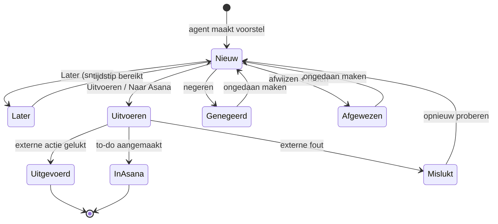

# PH-FLOW-003 — Voorstel beslissen

**Status:** PROPOSED · **Owner:** Lucas · **Last updated:** 2026-10-18 · **Bron:** SRC-DES-001 (Beslissen, detail-pop-up)

## Doel

Eén voorstel bekijken, eventueel aanpassen, en een beslissing nemen die altijd ongedaan kan worden.

## Toestanden van een voorstel

Zie ook `04-product/state-machines/proposal.md`.

## Stappen

1. Gebruiker opent een voorstel (kaart in Focusronde, rij in Inbox, item in Project Hub).
2. Detail toont: wat de agent wil doen, voor welk project, bron (link), "Waarom dit voorstel?", zekerheid.
3. Gebruiker kan de inhoud bewerken (tekst van mail of bericht, ontvanger, datum, taaknaam).
4. Beslissing:
   - **Uitvoeren** (volgende stap) of **Naar Asana** (to-do) → PH-FLOW-004.
   - **Later** → kies moment; komt dan terug als Nieuw.
   - **Negeren** → verdwijnt zonder feedback.
   - **Afwijzen** → kies reden ("Niet relevant", "Al gedaan", "Verkeerd project", "Verkeerde persoon", ...) → PH-FLOW-010.
5. Elke beslissing toont een melding met **Ongedaan maken**.

## Regels

- PH-BR-001 (voorgesteld): niets wordt naar buiten verstuurd zonder expliciete klik op Uitvoeren.
- PH-BR-006 (voorgesteld): ongedaan maken kan zolang de externe actie nog niet uitgevoerd is. **NEEDS_INPUT**: wat met een al verstuurde mail? Voorstel: korte wachttijd (bv. 10 seconden) vóór echt versturen.

## Open vragen

- Lijst met afwijsredenen definitief maken.
- Snooze-opties: vaste keuzes (morgen, volgende week) of vrij tijdstip?
