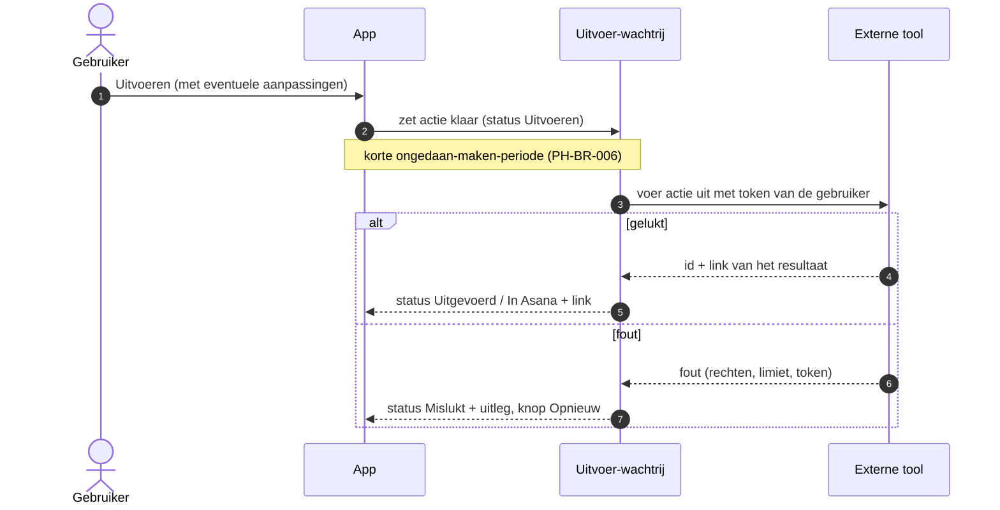

# PH-FLOW-004 — Goedgekeurd voorstel uitvoeren in een externe tool

**Status:** APPROVED (PH-DEC-008) · **Owner:** Lucas · **Last updated:** 2026-10-18 · **Bron:** SRC-DES-001 (actietypes in demodata)

## Doel

Een goedgekeurd voorstel echt uitvoeren in de juiste tool, en het resultaat terugmelden.

## Actietypes in het prototype

| Type | Tool | Wat gebeurt er | Schrijfrecht nodig |
|---|---|---|---|
| Mail | Gmail | concept of verzonden mail | ja (verzenden of concept maken) |
| Bericht | Slack | bericht in kanaal of DM | ja |
| Uitnodiging | Google Calendar | meeting aanmaken met deelnemers | ja |
| Pagina | Notion | pagina aanmaken of aanvullen | ja |
| To-do | Asana | taak in het gekoppelde project | ja |

## Stappen

## Open vragen

- **PH-DEC-011, NEEDS_INPUT**: mails echt versturen of enkel als concept in Gmail klaarzetten? Concept is veiliger en vraagt minder strenge Google-goedkeuring (zie `05-architecture/integrations.md`).
- Welke van de vijf actietypes horen in de eerste versie?
