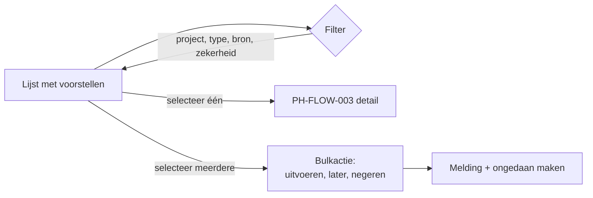

# PH-FLOW-005 — Inbox: voorstellen over alle projecten afhandelen

**Status:** APPROVED (PH-DEC-008) · **Owner:** Lucas · **Last updated:** 2026-10-18 · **Bron:** SRC-DES-001 (Inbox)

## Doel

Alle openstaande voorstellen over alle projecten in één lijst, snel filteren en in bulk afhandelen. Alternatief voor de focusronde.

## Stappen

1. Lijst toont per voorstel: project, type, korte tekst, bron, zekerheid, ouderdom.
2. Filters op project, type (stap/to-do), bron en zekerheid; zoeken.
3. Sneltoetsen om te navigeren en te beslissen (prototype: j/k, e, l, x, ...).
4. Bulkacties op meerdere voorstellen tegelijk.

## Regels

- PH-BR-007 (voorgesteld): bulk-uitvoeren vraagt een bevestiging met het aantal externe acties dat vertrekt.

## Open vragen

- Moet bulk-uitvoeren in v1, of alleen bulk later/negeren (veiliger)?
