# PH-FLOW-006 — Projecten opvolgen en een project openen

**Status:** APPROVED (PH-DEC-008) · **Owner:** Lucas · **Last updated:** 2026-10-18 · **Bron:** SRC-DES-001 (Projecten, Project Hub)

## Doel

Overzicht van alle projecten met gezondheid en fase, en per project één pagina met alles wat erover bekend is.

## Stappen

```mermaid
flowchart TD
  P[Projecten<br/>kaarten met gezondheid, fase, klant, open voorstellen] -->|filter| P
  P -->|open| H[Project Hub]
  H --> T1[Overzicht<br/>samenvatting, wat brandt, volgende mijlpaal]
  H --> T2[Beslissen<br/>voorstellen van dit project]
  H --> T3[Taken<br/>uit Asana]
  H --> T4[Team<br/>wie, laatste update, opvolgen]
  H --> T5[Context<br/>bronnen, documenten, meetings, koppelingen]
  T2 -.-> D[PH-FLOW-003]
  T4 -.-> S[PH-FLOW-007]
```

1. Projecten toont kaarten; filter op gezondheid (Op schema, Aandacht nodig, Kritiek), fase en klant.
2. Een project openen toont de Project Hub met vijf tabbladen.
3. Fase en gezondheid: de agent stelt voor, de gebruiker kan aanpassen.

## Open vragen

- **NEEDS_INPUT**: waar komt de projectlijst vandaan? Opties: (a) manueel aanmaken in de app, (b) automatisch uit Asana-projecten, (c) beide. Bepaalt PH-FLOW-008 en PH-FLOW-009.
- Wie mag de gezondheid overschrijven, en blijft die overschrijving staan na de volgende sync?
- Zijn de zeven fases vast, of per project instelbaar?
