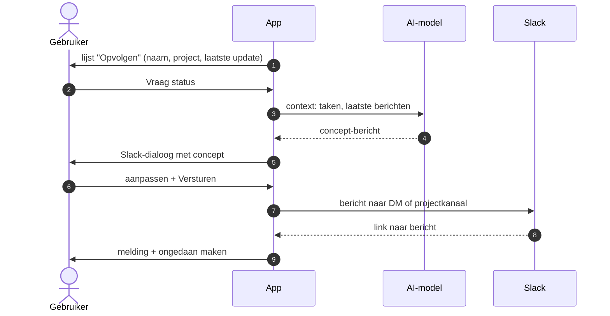

# PH-FLOW-007 — Team opvolgen met een statusvraag

**Status:** PROPOSED · **Owner:** Lucas · **Last updated:** 2026-10-18 · **Bron:** SRC-DES-001 (Opvolgen, Team-tab, Slack-dialoog)

## Doel

Teamleden van wie al even geen update kwam vriendelijk om status vragen, met een bericht dat de agent voorbereidt.

## Stappen

## Regels

- PH-BR-001 geldt: niets vertrekt zonder klik op Versturen.

## Open vragen

- DM of projectkanaal als standaard?
- Telt een antwoord in Slack automatisch als "update" (en verdwijnt de persoon dan uit Opvolgen)?
