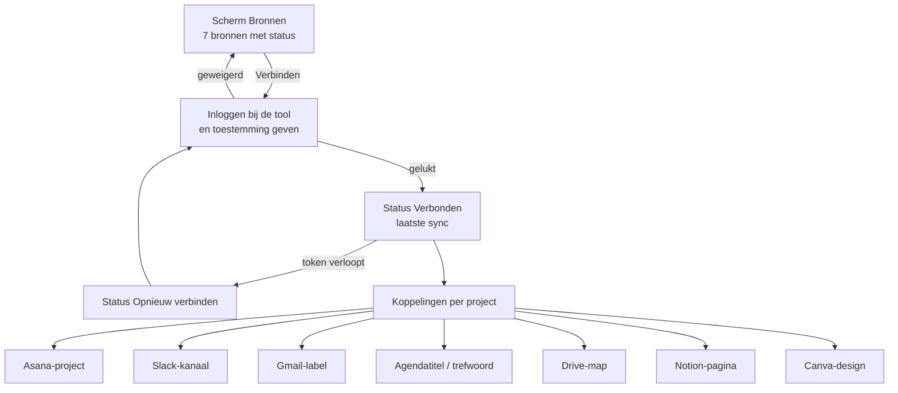

# PH-FLOW-008 — Bronnen verbinden en per project koppelen

**Status:** APPROVED (PH-DEC-008) · **Owner:** Lucas · **Last updated:** 2026-10-18 · **Bron:** SRC-DES-001 (Bronnen)

## Doel

De zeven bronnen verbinden met het account van de gebruiker, en per project aangeven welk stuk van elke bron erbij hoort.

## Stappen

1. Per bron: Verbinden → inlogscherm van die tool → toestemming → terug in de app.
2. Status per bron: Verbonden, Opnieuw verbinden, Niet verbonden; met laatste sync.
3. Per project kiest de gebruiker de koppelingen (lijst uit de tool, bv. Slack-kanalen).
4. Ontkoppelen verwijdert de toegang en stopt het lezen.

## Regels

- PH-BR-008 (voorgesteld): vraag per tool de kleinst mogelijke rechten; schrijfrechten pas vragen als een actietype dat nodig heeft.

## Open vragen

- Welke bronnen in v1? Zie PH-DEC-005 en `05-architecture/integrations.md` (Gmail en Drive vragen een Google-veiligheidscontrole bij publiek gebruik; Canva-API is beperkt).
- Kan de agent koppelingen voorstellen ("dit kanaal lijkt bij project X te horen")?
