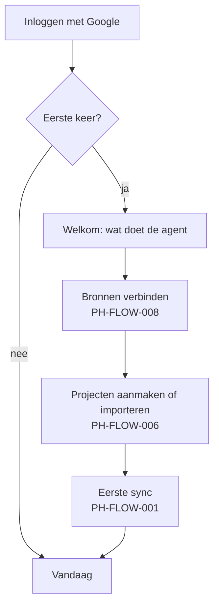

# PH-FLOW-009 — Aanmelden en eerste gebruik

**Status:** NEEDS_INPUT · **Owner:** Lucas · **Last updated:** 2026-10-18 · **Bron:** niet in het prototype

## Doel

Een gebruiker kan veilig inloggen en komt bij het eerste gebruik tot een gevulde Vandaag-pagina.

## Voorstel (te bevestigen)

## Open vragen (bepalen deze flow)

- **PH-DEC-007**: is dit een tool voor Lucas alleen, voor een klein team, of een product voor klanten? Dat bepaalt of er accounts, teams, rollen en betalingen nodig zijn.
- Inloggen met Google (handig omdat Gmail, Agenda en Drive toch Google zijn) of met e-mail en link?
