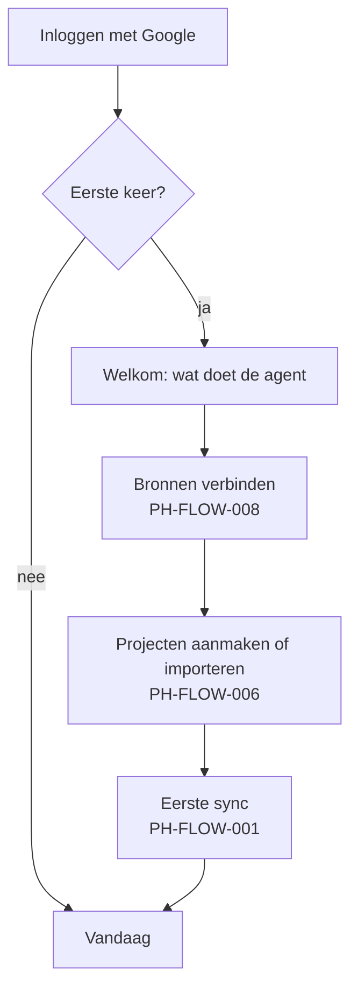

# PH-FLOW-009 — Aanmelden en eerste gebruik

**Status:** NEEDS_INPUT · **Owner:** Lucas · **Last updated:** 2026-10-19 · **Bron:** niet in het prototype

## Doel

Een gebruiker kan veilig inloggen en komt bij het eerste gebruik tot een gevulde Vandaag-pagina.

## Voorstel (te bevestigen)

## Open vragen (bepalen deze flow)

- **PH-DEC-007**: is dit een tool voor Lucas alleen, voor een klein team, of een product voor klanten? Dat bepaalt of er accounts, teams, rollen en betalingen nodig zijn.
- Inloggen met Google (handig omdat Gmail, Agenda en Drive toch Google zijn) of met e-mail en link?

## Loginmethode: opties (PH-DEC-018, gekozen: A, Google)

Vastgelegd: we bouwen de login zelf op Cloudflare (PH-DEC-016). Een externe logindienst (bv. Cloudflare Access, Auth0, Clerk) valt daarom af. Elke optie hieronder draait op de bestaande Worker; sessies bewaren we in Cloudflare D1 of KV (gratis plan).

| | A. Inloggen met Google | B. E-maillink | C. Passkey (vingerafdruk/Face ID) | D. E-mail + wachtwoord |
|---|---|---|---|---|
| Hoe | knop "Inloggen met Google" | je krijgt een link in je mailbox | je toestel bevestigt wie je bent | klassiek |
| Kost nu (alleen Lucas) | $0 | $0 | $0 | $0 |
| Kost bij echt gebruik | $0 | $0 (gratis e-maillimiet volstaat) | $0 | $0 |
| Kost bij verkoop (PH-DEC-007) | $0 | e-maildienst, vanaf een paar duizend mails per maand betalend | $0 | e-maildienst nodig voor "wachtwoord vergeten" |
| Extra dienst nodig | Google-project (gratis) | e-maildienst, bv. Resend of Cloudflare Email | geen | e-maildienst |
| Eigen werk | klein | klein | middel | groot (veiligheid, reset, lekken) |
| Valkuilen | Google-project moet later "gepubliceerd" worden voor andere gebruikers | mails kunnen in spam belanden | wat als je je toestel kwijt bent: herstelmethode nodig | wachtwoorden veilig bewaren is ons probleem |
| Past bij de rest | ja: Gmail, Agenda en Drive (PH-FLOW-008) vragen later toch een Google-koppeling | neutraal | neutraal | neutraal |

Prijzen: Google-login en passkeys hebben geen gebruikskost. Gratis e-maillimieten van Resend en Cloudflare Email zijn `UNSOURCED` en worden gecontroleerd met datum als Lucas voor B of D kiest.

**Gekozen door Lucas (2026-10-19):** A, inloggen met Google. Uitwerking en bouw: M2b in `12-roadmap/M2-schermen.md`. De welkomstappen voor de eerste keer (W1–W4 hierboven) komen pas met de bronnen in M4.
