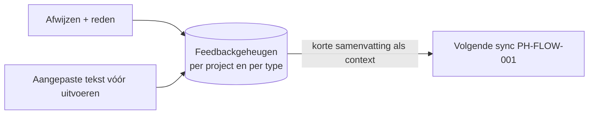

# PH-FLOW-010 — Agent leert van afwijsredenen

**Status:** PROPOSED · **Owner:** Lucas · **Last updated:** 2026-10-18 · **Bron:** SRC-DES-001 (afwijzen met reden)

## Doel

Minder slechte voorstellen na verloop van tijd, door afwijsredenen en aanpassingen mee te geven aan volgende syncs.

## Stappen

1. Elke afwijzing bewaart: voorstel, reden, project, bron.
2. Elke aanpassing vóór Uitvoeren bewaart het verschil (bv. toon van een mail).
3. Bij elke sync krijgt het model een korte samenvatting van recente feedback mee ("stel geen to-do's voor uit nieuwsbrieven").

## Regels

- PH-BR-009 (voorgesteld): leren gebeurt via context (instructies), niet via het trainen van een model. Goedkoop en uitlegbaar.

## Open vragen

- Kan de gebruiker het geleerde zien en wissen?
