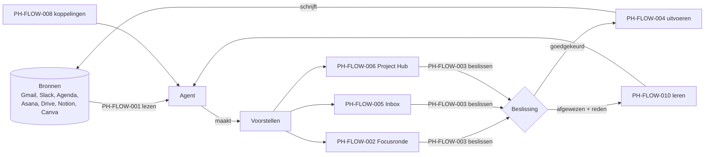

# Flows

**Status:** PROPOSED · **Owner:** Lucas · **Last updated:** 2026-10-18

Elke flow beschrijft wat een gebruiker of het systeem stap voor stap doet, los van de techniek. De flows zijn afgeleid uit het prototype (`SRC-DES-001`) en moeten door Lucas goedgekeurd worden vóór er gebouwd wordt (PH-DEC-003, PH-DEC-008).

Diagrammen staan in Mermaid; GitHub toont ze als tekening.

| ID | Flow | Wie start | Scherm(en) | Status |
|---|---|---|---|---|
| [PH-FLOW-001](PH-FLOW-001-agent-sync.md) | Agent leest bronnen en maakt voorstellen | systeem (planning) of gebruiker ("Nu syncen") | Bronnen, Vandaag | PROPOSED |
| [PH-FLOW-002](PH-FLOW-002-focusronde.md) | Dagelijkse focusronde | gebruiker | Vandaag, Focusronde | PROPOSED |
| [PH-FLOW-003](PH-FLOW-003-voorstel-beslissen.md) | Voorstel beslissen | gebruiker | Focusronde, Inbox, Project Hub, detail-pop-up | PROPOSED |
| [PH-FLOW-004](PH-FLOW-004-voorstel-uitvoeren.md) | Goedgekeurd voorstel uitvoeren in een externe tool | systeem, na klik | — | PROPOSED |
| [PH-FLOW-005](PH-FLOW-005-inbox-triage.md) | Inbox: voorstellen over alle projecten afhandelen | gebruiker | Inbox | PROPOSED |
| [PH-FLOW-006](PH-FLOW-006-projectbeheer.md) | Projecten opvolgen en een project openen | gebruiker | Projecten, Project Hub | PROPOSED |
| [PH-FLOW-007](PH-FLOW-007-teamopvolging.md) | Team opvolgen met een statusvraag | gebruiker | Focusronde (Opvolgen), Project Hub (Team), Slack-dialoog | PROPOSED |
| [PH-FLOW-008](PH-FLOW-008-bronnen-koppelen.md) | Bronnen verbinden en per project koppelen | gebruiker | Bronnen | PROPOSED |
| [PH-FLOW-009](PH-FLOW-009-aanmelden.md) | Aanmelden en eerste gebruik | gebruiker | (ontbreekt in prototype) | NEEDS_INPUT |
| [PH-FLOW-010](PH-FLOW-010-leren-van-feedback.md) | Agent leert van afwijsredenen | systeem | detail-pop-up | PROPOSED |

## Overzicht: hoe de flows samenhangen

## Template

Nieuwe flows volgen `templates/flow-template.md`.
