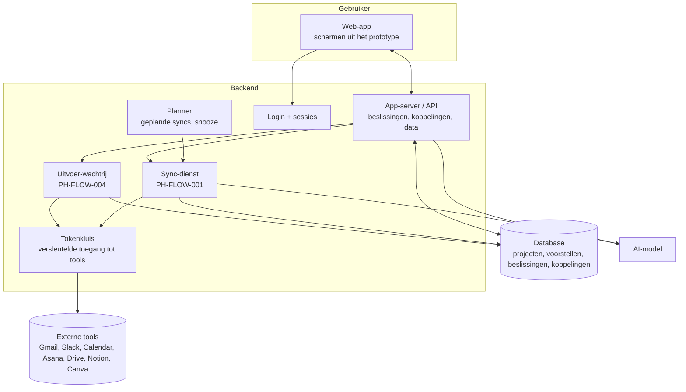

# Architectuur

**Status:** PROPOSED · **Owner:** Lucas · **Last updated:** 2026-10-18

Dit is de **logische** architectuur: welke onderdelen er zijn en wat ze doen, zonder leverancier. Welke dienst elk onderdeel invult, kiest Lucas in PH-DEC-006 op basis van `stack-options.md`.

## Onderdelen

| Onderdeel | Taak | Eisen die de stackkeuze beïnvloeden |
|---|---|---|
| Web-app | schermen, sneltoetsen, licht/donker | het prototype is HTML/CSS; elke moderne webtechniek kan het overnemen |
| App-server / API | logica, rechten per gebruiker | moet tokens veilig bewaren; nooit tokens in de browser |
| Login | inloggen (voorstel: Google) | kan zelf of via een dienst |
| Sync-dienst | bronnen lezen, AI aanroepen | kan minuten duren → moet lang genoeg mogen draaien of in stukken |
| Planner | syncs op vaste tijden, snooze | gratis plannen zijn hier vaak beperkt (zie stack-options) |
| Uitvoer-wachtrij | externe acties met wachttijd en opnieuw proberen | betrouwbaarheid, logging |
| Tokenkluis | OAuth-tokens versleuteld | veiligheidseis, niet onderhandelbaar |
| Database | relationele data | klein volume (honderden voorstellen per maand) |
| AI-model | voorstellen, samenvattingen, concepten | grootste variabele kost; los van de hosting te kiezen |

## Verdere documenten

- `stack-options.md` — vier stackopties met kostprijs (beslissing PH-DEC-006)
- `integrations.md` — per bron: wat lezen, wat schrijven, wat zijn de drempels
- `data-model.md` — logische entiteiten
- `security-privacy.md` — wat we bewaren en hoe
