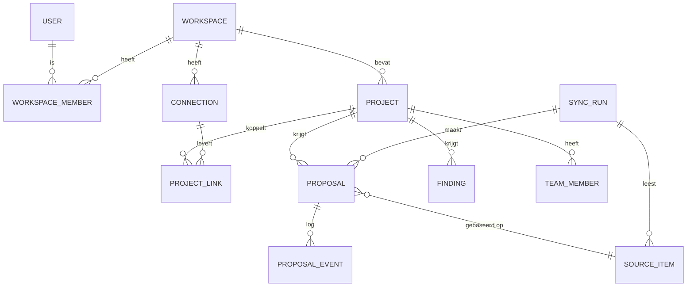

# Logisch datamodel

**Status:** PROPOSED · **Last updated:** 2026-10-18

Onafhankelijk van de database. Velden zijn indicatief.

| Entiteit | Belangrijkste velden |
|---|---|
| USER | id, naam, e-mail |
| WORKSPACE | id, naam (één per gebruiker of per team, hangt af van PH-DEC-007) |
| PROJECT | id, naam, klant, fase, gezondheid (agent / overschreven), volgende mijlpaal |
| CONNECTION | bron (gmail, slack, …), status, scopes, versleuteld token, laatste sync |
| PROJECT_LINK | project, connection, extern id (kanaal, label, map, …) |
| SOURCE_ITEM | bron, extern id, link, tijd, korte samenvatting (geen volledige inhoud, PH-DEC-010) |
| PROPOSAL | project, soort (stap / to-do), actietype, inhoud (bewerkbaar), uitleg, zekerheid, status, snooze-tijd, resultaatlink |
| PROPOSAL_EVENT | voorstel, van-status, naar-status, door, tijd, reden |
| FINDING | project, tekst, bron, ernst ("brandt") |
| TEAM_MEMBER | project, naam, Slack-id, laatste update |
| SYNC_RUN | start, einde, aantal items, aantal voorstellen, tokens gebruikt, kost |

`SYNC_RUN` bewaart ook tokenverbruik en kost, zodat de echte AI-kost zichtbaar wordt in het dashboard.
