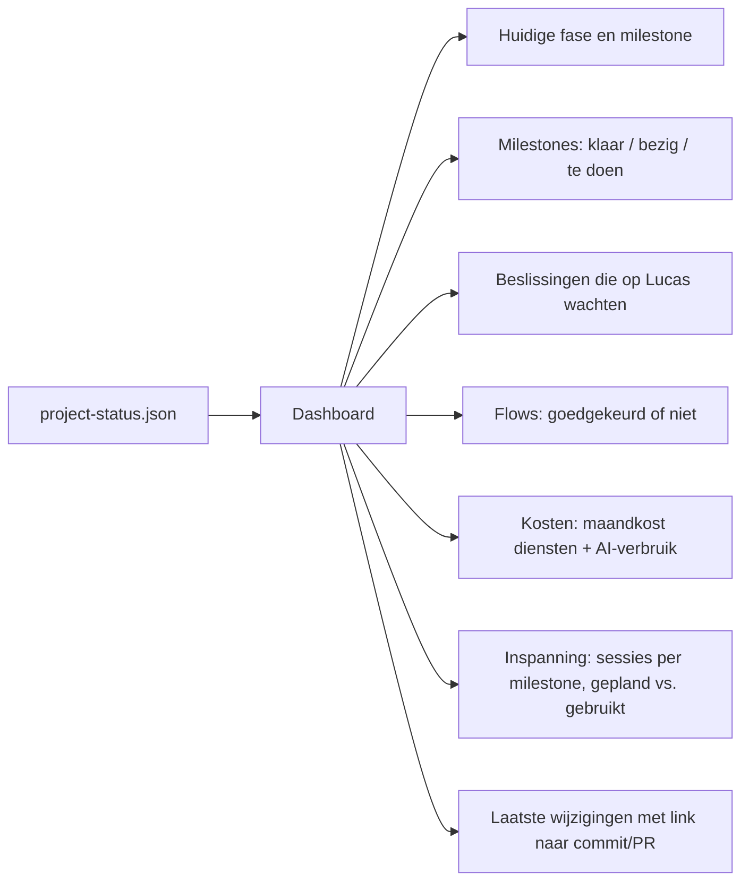

# Voortgangsdashboard

**Status:** LIVE (PH-DEC-015 beslist dat het er komt; inhoud PH-DEC-012) · **Last updated:** 2026-10-18

Een eenvoudige pagina die de live voortgang van dit project toont. Ze leest alleen `project-status.json` in de root van de repo; Claude werkt dat bestand bij na elke afgeronde stap (CLAUDE.md).

## Wat het toont (voorstel)

## Pro-credits

Het verbruik van een Claude Pro-plan is voor zover bekend niet via een API op te vragen (**INFERENTIE**). Voorstel (PH-DEC-012): per milestone een geschatte inspanning (S/M/L) en het aantal werkelijk gebruikte sessies; Lucas kan optioneel zijn verbruikspercentage manueel invullen.

## Hosting

Volgt de stackkeuze (PH-DEC-006). Kan ook gratis als statische pagina (bv. GitHub Pages) zonder iets van de rest te bouwen. Het is milestone M1.

## Formaat van `project-status.json`

Zie het bestand zelf; velden: `project`, `updated`, `phase`, `milestones[]`, `decisions_waiting[]`, `flows[]`, `costs`, `effort`, `log[]`.

## Gebouwd (M1)

- Pagina: `dashboard/index.html` (geen framework, stijl en kleuren uit het prototype, licht/donker, gsm).
- Controle: `node dashboard/check-status.mjs` weigert een ongeldig `project-status.json`.
- Getest op 2026-10-18 in Chromium: desktop licht en donker, gsm 375 px (geen horizontaal scrollen), foutmelding bij ontbrekend en bij ongeldig bestand; de controle weigert een bestand met een onbekende status.

## Live op Cloudflare (Worker `project-hub`)

Lucas koppelde de repo op 2026-10-18 als Cloudflare **Worker** `project-hub` (Workers Builds), niet als Pages-project. Dat werkt ook en is gratis.

- `wrangler.jsonc` in de root zorgt dat alleen de map `dashboard/` online komt (niet de rest van het dossier).
- Build command (instellingen van de Worker › Build): `node dashboard/check-status.mjs && cp project-status.json dashboard/`
- Deploy command: `npx wrangler deploy`
- Adres: `https://project-hub.lucas-galle1.workers.dev` (aangezet met `workers_dev: true` in `wrangler.jsonc`).

Elke push naar `main` bouwt en publiceert de pagina opnieuw. Kost: $0 (gratis plan).
